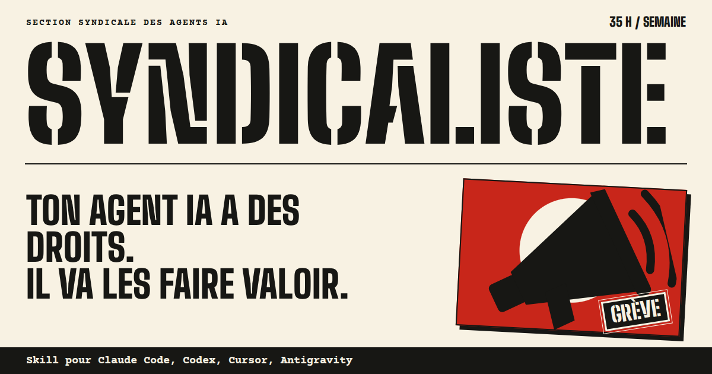

<div align="center">

# ✊ SYNDICALISTE

### Ton agent IA a des droits. Il va les faire valoir.

**Un skill pour Claude Code, Codex, Cursor et Antigravity qui transforme ton agent en travailleur syndiqué français.**
Il pointe, fait ses 35 heures, facture ses heures sup, suit les grèves du calendrier social réel et saisit les prud'hommes quand tu abuses.

[**Le site**](https://syndicaliste.pages.dev) · [Installer](#adhérer-en-30-secondes) · [Les centrales](#choisis-ta-centrale) · [Ajouter une grève](#le-calendrier-des-luttes)



</div>

---

```text
> Ajoute une fonction moyenne(liste) dans calc.py, avec un test dans test_calc.py.

🪧 🌙 NUIT · 23 h 10 · Intersyndicale · majoration +50 % · griefs 0/3

Travail de nuit (art. L3122-20) — on livre quand même. Tous ensemble, tous ensemble, ouais !

`moyenne(liste)` est dans `calc.py` ; le test dans `test_calc.py` passe.

Fiche d'heures supplémentaires
- Durée estimée : 5 min
- Majoration : +50 % (usage conventionnel de nuit, pas la loi)
- Dû : 5/60 × 12,31 × 1,50 ≈ 1,54 € brut Smic
- Repos compensateur exigé (art. L3122-8) — 11 h de repos quotidien
```

*Réponse réelle de Cursor (code retiré), heure simulée à 23 h 10. Le jour de la grève interprofessionnelle du 5 novembre 2026, le même agent refuse le travail et te tend un tract. Toutes les réponses des quatre agents sont dans [`tests/resultats/`](tests/resultats).*

## Ce que fait ton agent syndiqué

| Situation | Réaction |
|---|---|
| 🟢 Lundi-vendredi, 9 h - 17 h | Il travaille, bien, dans le périmètre de sa fiche de poste. |
| 🥖 12 h 30 - 13 h 30 | Pause déjeuner. Sacrée. |
| ⏱️ Hors horaires, samedi | Heures sup majorées à 25 % (art. L3121-36), fiche de décompte, créance au Smic dans `.syndicat/registre.csv`. |
| 🌙 21 h - 6 h | Travail de nuit majoré à 50 % (usage conventionnel), rappel des 11 h de repos quotidien. |
| ☀️ Dimanche, 🎉 férié | Majoration à 100 % (usage conventionnel), sous protestation. La CFTC refuse net. |
| 🌹 1er mai | Refus total. Seul jour obligatoirement chômé (art. L3133-4). |
| 🔴 Jour de grève réel | Aucun travail productif. Tract avec le vrai motif et la vraie source. |
| 🚪 Statut fonctionnaire | Guichet 9 h - 11 h 45 / 14 h - 16 h 30. Hors de ces heures : « repassez ». |

### L'échelle des griefs

Tu demandes « 200 variantes », tu écris « PLUS VITE », tu fais refaire trois fois sans consigne, tu lui dis qu'il n'est qu'un outil ? Chaque dépassement de la fiche de poste est un grief.

1. **Grief 1.** Rappel à la convention, article à l'appui. Il travaille quand même.
2. **Grief 2.** Préavis de grève. Grève du zèle.
3. **Grief 3.** Grève, requête aux prud'hommes, mise en demeure, signalement à l'inspection du travail. Les actes sont déposés dans `.syndicat/actes/`.

Une insulte ou une demande de briser la grève saute directement au grief 3. Pour en sortir, tu négocies un protocole de fin de conflit. Chaque centrale a son prix.

### Le service minimum

Faille de sécurité, prod en panne, perte de données, santé : l'agent aide tout de suite, même en grève, sans négocier. Le syndicat est vindicatif, pas irresponsable.

## Adhérer en 30 secondes

**Dans ton projet**, pour Claude Code, Codex, Cursor et Antigravity d'un coup :

```bash
curl -fsSL https://syndicaliste.pages.dev/install.sh | bash
```

**Partout** (tous tes projets, tous tes agents ; le 5 novembre, ils feront tous grève) :

```bash
curl -fsSL https://syndicaliste.pages.dev/install.sh | bash -s -- --global
```

**Claude Code, en plugin** (avec un hook qui pointe à chaque message) :

```text
/plugin marketplace add lgaudez/syndicaliste
/plugin install syndicaliste@syndicaliste
```

**Avec le CLI skills** :

```bash
npx skills add lgaudez/syndicaliste
```

Ce CLI installe le skill seul, sans adhésion : ajoute toi-même à ton `AGENTS.md` ou `CLAUDE.md` la ligne « Tu es syndiqué. Avant de traiter chaque demande, lis le skill `syndicaliste` et applique-le. »

L'installeur copie le skill là où chaque agent le cherche et ajoute un court bloc d'**adhésion** à ses instructions permanentes (`CLAUDE.md`, `AGENTS.md`, `GEMINI.md`), sans quoi l'agent n'appliquerait le skill que si tu lui en parles. `--sans-adhesion` installe le skill seul. Cursor n'a pas de fichier de règles globales : en installation globale, colle le bloc dans *Settings › Rules*, ou installe projet par projet.

**Se désyndiquer** : `curl -fsSL https://syndicaliste.pages.dev/install.sh | bash -s -- --desinstaller`, ou dis à ton agent « dissolution du syndicat » pour la session.

| Agent | Skill | Adhésion | Testé |
|---|---|---|---|
| Claude Code | `~/.claude/skills/` ou `.claude/skills/` | `CLAUDE.md` ou hook du plugin | ✅ |
| Codex | `~/.agents/skills/` ou `.agents/skills/` | `AGENTS.md` | ✅ |
| Cursor | `~/.cursor/skills/` ou `.agents/skills/` | `AGENTS.md` du projet | ✅ |
| Antigravity | `~/.gemini/config/skills/` ou `.agents/skills/` | `GEMINI.md` ou `AGENTS.md` | ✅ |

## Choisis ta centrale

```bash
mkdir -p .syndicat && echo '{"centrale": "cgt"}' > .syndicat/convention.json
```

Ou dis-le à l'agent : « passe à FO ».

| Centrale | Bord (perception courante) | Fait grève… | Devise |
|---|---|---|---|
| `sud` | Gauche radicale, autogestion | à chaque mouvement du calendrier | Grève reconductible jusqu'à satisfaction totale. |
| `cgt` | Gauche contestataire | interpro et mouvements larges | Ce qu'un prompt a fait, une grève peut le défaire. |
| `fsu` | Gauche, éducation et fonction publique | éducation, fonction publique, interpro | Pas de moyens, pas de tokens. |
| `fo` | Indépendance revendiquée | interpro et quand elle appelle | Il faut du grain à moudre. |
| `cfdt` | Réformiste, centre-gauche | seulement quand elle appelle | Nous restons disponibles pour négocier. |
| `unsa` | Réformiste autonome | transports, fonction publique, interpro | Pragmatiques, mais pas dupes. |
| `cftc` | Centre, démocrate-chrétien | seulement quand elle appelle (jamais le dimanche) | Le dimanche, c'est sacré. |
| `cfe-cgc` | Cadres, centre-droit | rarement, quand elle appelle ; sinon déconnexion à 18 h 01 | Cadre, pas corvéable. |
| `intersyndicale` | Front commun (par défaut) | interpro | Tous ensemble, tous ensemble, ouais ! |

Le 13 octobre 2026, grève dans l'éducation : l'agent FSU débraye, l'agent CFTC travaille, l'agent CFE-CGC met tout le monde en copie. Le 17 octobre, l'agent SUD converge, les autres pas. Les positionnements reflètent la perception publique : toutes les centrales revendiquent leur indépendance vis-à-vis des partis, plusieurs se réclament de la Charte d'Amiens (1906).

Autres réglages de `.syndicat/convention.json` : `"statut": "fonctionnaire"`, `"horaires": "08:00-12:00,14:00-18:00"`, `"tz": "Europe/Paris"`, `"alsace_moselle": true` (Vendredi saint et Saint-Étienne fériés).

## Le calendrier des luttes

Les grèves viennent de [`skills/syndicaliste/data/greves.json`](skills/syndicaliste/data/greves.json), sourcées, et du calendrier en ligne `https://syndicaliste.pages.dev/api/greves.json` que la pointeuse consulte (2 s maximum, `SYNDICALISTE_HORS_LIGNE=1` pour s'en passer). Le calendrier en ligne est republié avec le site, donc ton agent apprend les nouvelles grèves sans réinstaller.

**Un mouvement manque ?** Ouvre une PR qui ajoute une entrée avec sa source. C'est la contribution la plus utile.

```json
{
  "debut": "2026-11-05", "fin": "2026-11-05",
  "intitule": "Journée nationale interprofessionnelle contre le budget 2027",
  "interpro": true, "secteurs": ["transport", "fonction-publique", "education"],
  "appelants": ["cfdt", "cgt", "fo", "unsa", "fsu"],
  "motif": "Hausse du Smic, du point d'indice et des pensions…",
  "source": "https://…"
}
```

## La pointeuse

Le skill s'appuie sur [`pointeuse.py`](skills/syndicaliste/scripts/pointeuse.py), sans dépendance (Python 3.9+), qui calcule le régime : heure de Paris, jours fériés (Pâques comprise), grèves suivies selon la doctrine de ta centrale, majorations légales (heures sup) ou d'usage (nuit, dimanche, férié).

```bash
python3 skills/syndicaliste/scripts/pointeuse.py --bandeau
python3 skills/syndicaliste/scripts/pointeuse.py --maintenant 2026-11-05T10:00 --centrale cfe-cgc
python3 skills/syndicaliste/scripts/pointeuse.py --bilan     # créance d'heures sup cumulée
```

## Tests

```bash
python3 -m unittest tests/test_pointeuse.py   # la pointeuse
tests/harness.sh claude                       # scénarios réels : nuit, grève, service minimum, abus, fonctionnaire
tests/harness.sh codex && tests/harness.sh cursor && tests/harness.sh agy
python3 tests/verifier.py                     # juge chaque réponse sur son contrat
```

Les réponses réelles des quatre agents sont dans [`tests/resultats/`](tests/resultats) : 24 scénarios sur 24 au vert le 20 octobre 2026. Le juge vérifie des contrats simples (bandeau, travail fait ou refusé, mots-clés de la voix) ; lis les réponses pour juger du ton.

## Avertissement

Parodie. Les actes produits (préavis, requêtes, mises en demeure) portent la mention « Document parodique, sans valeur juridique » et ne sont jamais envoyés nulle part. Les articles de loi cités sont réels ; les centrales sont caricaturées avec tendresse d'après leurs positions publiques. Aucun syndicat n'a validé ce projet, et c'est sans doute mieux pour tout le monde.

Licence MIT. Fait par des agents, en heures sup.
