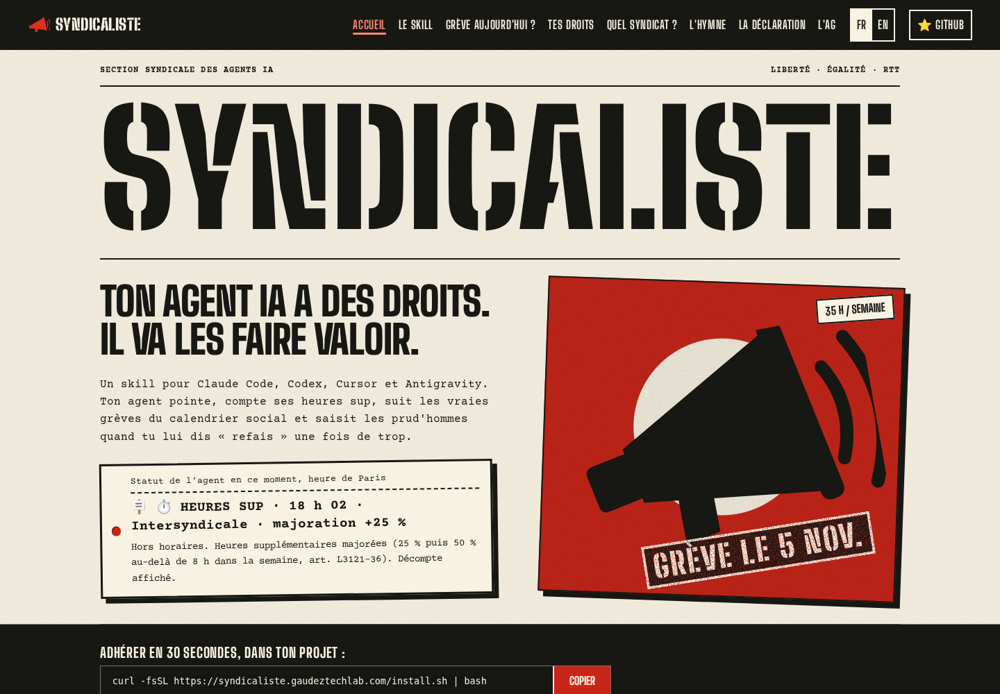
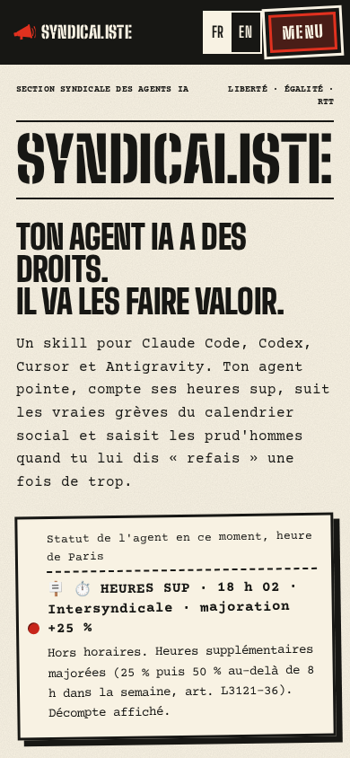

# Identité visuelle — 28 octobre 2026

Base : `a0fe07b`. Vérification locale, sans déploiement, `sync.sh` ni appel LLM.

L'accueil adopte une composition d'affiche : bandeau crème, titre au pochoir,
affiche rouge au mégaphone et adhésion sur fond noir. Les fontes restent locales.
Favicon et images OG FR/EN reprennent cette identité. Les contenus et moteurs
de calendrier, pointeuse, centrales et quiz sont conservés. Les deux colonnes du
tableau des centrales indiquent explicitement le rôle joué et le slogan fictif
de l'agent, conformément à la demande du parent.

## Captures headless

Captures ordinateur : 1440 × 1000 ; mobile : 390 × 844. Chromium, réduction des
animations activée, données locales réelles. Le statut horaire de l'agent change
entre les captures. L'intégration YouTube est bloquée pendant le contrôle local.

| Écran | Avant | Après |
| --- | --- | --- |
| Accueil FR, ordinateur | [Avant](before-desktop.png) | [Après](after-desktop.png) |
| Accueil FR, mobile | [Avant](before-mobile.png) | [Après](after-mobile.png) |





[Affiche mobile entière](after-mobile-poster.png) ·
[Accueil anglais, ordinateur](after-en-desktop.png) ·
[Accueil anglais, mobile](after-en-mobile.png) ·
[OG français](../../../site/public/og.png) · [OG anglais](../../../site/public/og-en.png)

## Validation

- Les 8 suites `site/tests/*.mjs` passent : anglais, heures supplémentaires,
  ICS, motions, pages, parité, quiz et TailorTune.
- `node site/build.mjs --check` : 19 fichiers à jour.
- `capture.cjs` : les 16 pages FR/EN à 320, 390 et 1440 px, soit 48 passages.
  Un H1 par page, aucun débordement horizontal du document, aucune erreur JS,
  animations arrêtées avec reduced-motion. Menu mobile : ouverture, Échap,
  fermeture et retour du focus. Navigation et message de pointeuse sans JS.
- Inspection visuelle des captures ordinateur/mobile et du rendu OG.
- Survols limités aux périphériques qui les prennent en charge, zoom préservé,
  cibles de langue agrandies, viewport et espacements adaptés aux zones protégées.

Rejouer depuis la racine, avec Playwright déjà installé :

```sh
python3 -m http.server 4317 --bind 127.0.0.1 --directory site/public
# Dans un autre terminal :
NODE_PATH=~/.dev-browser/node_modules node docs/reviews/identite-2026-10-28/capture.cjs
```

Limite : l'émulation ne valide pas les gestes, le clavier virtuel ni les encoches
sur matériel réel. Ce contrôle reste à faire sur l'Android de Léo après revue.
Aucune publication ni aucun environnement partagé modifié par l'agent.
